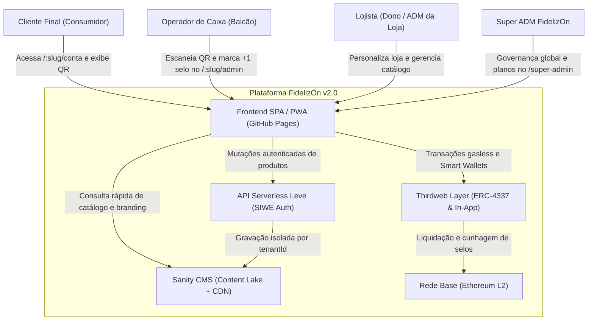
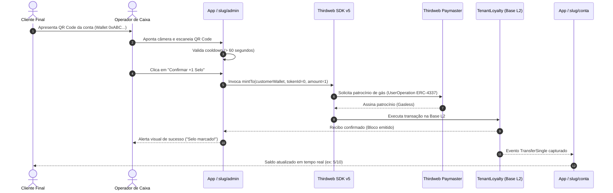
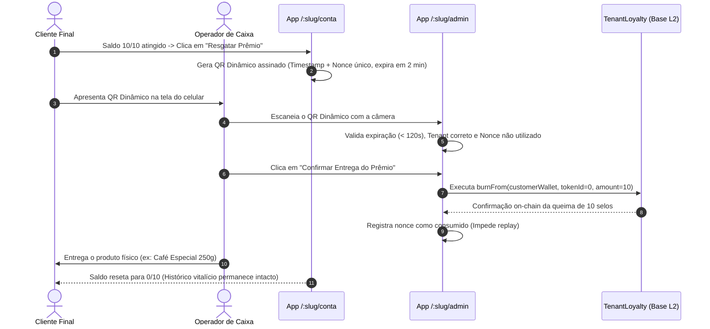

# Documentação Técnica: FidelizOn (v2.0)
### Especificação Canônica de Arquitetura SaaS B2B2C, Engenharia Multi-Tenant e Camada Web3 Invisível

- **Projeto:** FidelizOn Platform
- **Versão:** 2.0.0
- **Classificação:** Arquitetura de Software Web3, Distributed Systems, Multi-Tenant SaaS & CMS Integration
- **Padrão de Conformidade:** C4 Model, EIP Standards (ERC-1155, ERC-4337, EIP-712), W3DAAF (Progressive Decentralisation / Thin Client)

---

## 1. Conceito, Propósito e Estratégia de Produto

### 1.1. Proposta de Valor
A **FidelizOn** é uma plataforma SaaS Web3 de fidelização digital e autoatendimento projetada para o varejo físico e food service (cafeterias, restaurantes, empórios e comércios de conveniência). 

Ela substitui os tradicionais cartões de papel perfurados e os aplicativos convencionais pesados por um ecossistema leve e sem atrito:
- **Para o Lojista (B2B):** Contratação self-service, hotsite com marca própria, catálogo de produtos em nuvem, controle de operadores de caixa e campanhas sazonais (Black Friday) com garantia contra fraudes.
- **Para o Consumidor (B2C):** Acesso instantâneo via QR Code no navegador do celular (PWA), sem download de app de loja, sem senhas esquecidas e com acúmulo transparente de selos e benefícios.

```
"Fidelidade digital ágil, sem atrito de app, com auditoria e segurança Web3 nos bastidores."
```

### 1.2. Pilares Estratégicos de Arquitetura

1. **Web3 Invisível (Zero-Crypto UX):**
   Nem o lojista nem o cliente final precisam entender de chaves privadas, gás ou redes blockchain. O login utiliza **In-App Wallets** da Thirdweb (Google ou e-mail OTP) e as transações de selo são 100% patrocinadas via **Account Abstraction (ERC-4337)**.
2. **Arquitetura Enxuta e Baixo Custo Operacional (Zero-Server Frontend):**
   O frontend é uma Single Page Application (SPA / PWA) estática servida via **GitHub Pages** acelerada por CDN global, reduzindo drasticamente custos de infraestrutura de servidores.
3. **Gestão de Conteúdo e Catálogo em Nuvem (Sanity CMS):**
   Os dados de hotsite, branding, produtos e campanhas residem no **Sanity Content Lake** e são consumidos em alta velocidade pelo frontend via **Sanity CDN**.
4. **Segurança Crítica na Leitura de QR Code (Regra de Ouro):**
   - **QR Code Estático:** Utilizado exclusivamente para **receber** benefícios (`+1` selo ou recarga de saldo).
   - **QR Code Dinâmico com EIP-712:** Qualquer operação de **gasto ou queima** (resgate de prêmio, débito de pré-pago ou uso de cupom) exige um QR Code dinâmico assinado, com validade máxima de **2 minutos** e proteção estrita contra repetição (*replay attack* via nonce).

---

## 2. Matriz de Tecnologias

| Camada | Tecnologia | Versão | Função Primária |
| :--- | :--- | :--- | :--- |
| **Frontend Framework** | React + TypeScript | React 19 / TS 5.7+ | Interface declarativa responsiva e tipada |
| **Build & Tooling** | Vite | 6.2.0 | Compilação SPA ultraveloz e empacotamento estático |
| **Estilização & Design** | Tailwind CSS + Lucide React | Tailwind 3.4+ | Design responsivo mobile-first e temas visuais |
| **CMS & Catálogo** | Sanity CMS | 6.28+ | Content Lake, Sanity CDN e gestão multi-tenant |
| **Camada Web3** | Thirdweb SDK v5 | 5.93+ | In-App Wallets, Account Abstraction e chamadas contratuais |
| **Padrão de Contrato** | ERC-1155 (Minimal Clones EIP-1167) | EIP-1155 | Coleções isoladas por lojista para selos e cupons |
| **Patrocínio de Gás** | ERC-4337 Paymaster | Base L2 Bundler | Transações sem custo para lojistas e clientes |
| **Rede Blockchain** | Base (L2) / Base Sepolia | OP Stack Rollup | Finalidade rápida (< 2s) e taxas ultrabaixas |
| **Test Runner** | Vitest + Testing Library | Vitest 3.0+ | Testes de unidade e integrados automatizados |
| **Hospedagem & CI/CD**| GitHub Pages + GitHub Actions | Static Hosting | Entrega contínua com fallback SPA (`404.html`) |

---

## 3. Diagramas de Arquitetura (C4 Model)

### 3.1. Contexto do Sistema (C4 Context)



---

### 3.2. Ciclo Transacional: Operador Pontua Cliente no Caixa (Jornada B3)



---

### 3.3. Ciclo Transacional: Resgate Seguro de Recompensa (QR Dinâmico EIP-712)



---

## 4. Matriz de Perfis e Hierarquia de Acesso (RBAC)

| Papel | Escopo | Mecanismo de Autenticação | Permissões Principais |
| :--- | :--- | :--- | :--- |
| **Super ADM** | Plataforma | Wallet Master (`PLATFORM_ADMIN`) | Gestão de lojistas, cotas de Paymaster, planos de assinatura e Sanity Studio. |
| **Lojista (Dono)** | Estabelecimento | In-App Wallet (`TENANT_ADMIN_ROLE`) | Customização de branding, catálogo de produtos, campanhas Black Friday e equipe. |
| **Operador de Caixa**| Estabelecimento | In-App Wallet (`OPERATOR_ROLE`) | Leitura de QR code, atribuição de `+1` selo e baixa segura em prêmios/pedidos. |
| **Cliente Final** | Consumidor | In-App Wallet (Google/E-mail OTP) | Consulta de selos, exibição de QR Code, autoatendimento e assinatura de resgates. |

---

## 5. Guias Operacionais e Manuais de Referência

Para configurar e operar o projeto, consulte a biblioteca de guias na pasta `docs/`:
- [Guia Rápido via Terminal (IaC)](docs/SETUP_VIA_CODE.md): Comandos e esteira automatizada.
- [Tutorial de Variáveis de Ambiente](docs/TUTORIAL_ENV.md): Documentação detalhada do `.env`.
- [Guia do Thirdweb Dashboard](docs/THIRDWEB_CONFIG_GUIDE.md): Configuração de API Keys, domínios e Paymaster.
- [Guia do Sanity CMS](docs/SANITY_SETUP_GUIDE.md): Content Lake, CORS e gestão de schemas.
