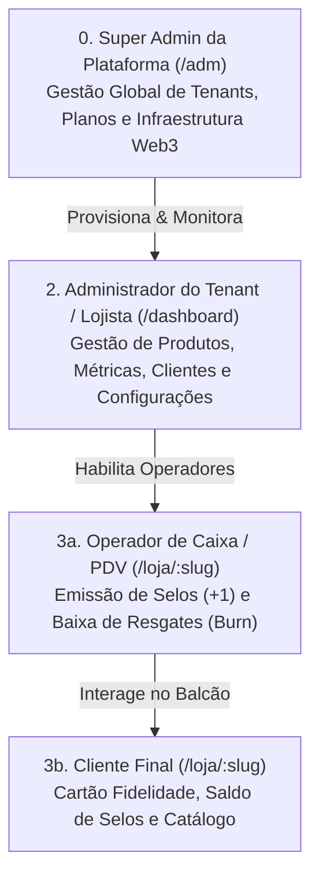
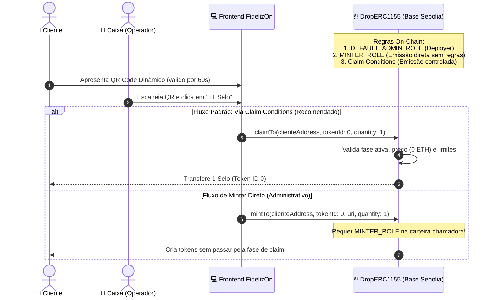

# 🏛️ Manual de Administração da Plataforma FidelizOn
## Arquitetura Multi-Tenant B2B2C, Governança On-Chain e Operação

Este documento estabelece a especificação oficial de **Administração da Plataforma FidelizOn**, detalhando o funcionamento da governança global da plataforma, os papéis de acesso (*roles*), a operação dos contratos inteligentes (`DropERC1155`) na rede **Base**, a gestão de estabelecimentos (*tenants*) no **Sanity CMS** e as diretrizes operacionais de segurança contra fraudes.

---

## 1. Visão Geral da Arquitetura Multi-Tenant

A FidelizOn opera sob o modelo **B2B2C (Business to Business to Consumer)** com segregação de responsabilidades em 4 camadas de acesso:



### Matriz de Papéis e Permissões (RBAC & On-Chain)

| Papel | Escopo | Autenticação | Permissões no Sistema | Permissões On-Chain (Base Sepolia) |
| :--- | :--- | :--- | :--- | :--- |
| **Super Admin Plataforma** | Global | Carteira Deployer / Admin Core | Gestão de todos os tenants, faturamento SaaS, auditoria de contratos e suspensão de contas. | `DEFAULT_ADMIN_ROLE` (`0x00...`): Controle irrestrito do contrato, concessão/revogação de roles, claim phases e royalties. |
| **Lojista (Tenant Admin)** | Estabelecimento (`:slug`) | Carteira do Dono (`ownerWallet`) ou E-mail OTP | Cadastro de produtos, cupons, definição de metas de fidelidade, visualização de extratos e métricas. | `TENANT_ADMIN_ROLE`: Configuração de regras locais e autorização de caixas. |
| **Operador de Caixa (PDV)** | Loja no Ponto de Venda | Carteira do Caixa ou Token de Sessão PDV | Leitura de QR Code dinâmico do cliente, confirmação de selos e validação de prêmios. | Chamada à função de **Claim** (`claimTo`) sob Claim Conditions aprovadas ou `MINTER_ROLE`. |
| **Cliente Consumidor** | Carteira Pessoal | In-App Wallet (Google/E-mail) ou Web3 Wallet | Visualização de saldo de selos, exibição de QR Code de fidelidade e pedidos de autoatendimento. | Titular do saldo ERC-1155 (Token ID 0) e autorização de queima (`burn`) para resgate. |

---

## 2. Governança On-Chain: Smart Contracts & Regras de Acesso

O ecossistema Web3 da FidelizOn utiliza o padrão **Thirdweb DropERC1155** (`OpenZeppelin AccessControlUpgradeable`) deployado na rede **Base Sepolia**:

> **Contrato Ativo Staging:** [`0x6883FD842E0b7901873a6a00042B602991a6bd2E`](https://sepolia.basescan.org/address/0x6883FD842E0b7901873a6a00042B602991a6bd2E)  
> **Token ID 0:** Selo Oficial FidelizOn (ex.: Cafeteria Aroma).

### 2.1. Diferença entre `DEFAULT_ADMIN_ROLE`, `MINTER_ROLE` e `claimTo`

A arquitetura on-chain possui duas formas distintas de emissão de selos, e compreender essa separação é vital para a administração segura:



#### A. A Role Administrativa (`DEFAULT_ADMIN_ROLE`)
* **Quem detém:** Apenas a carteira dona/deployer da plataforma.
* **Poderes:**
  - Adicionar ou revogar qualquer papel on-chain via `grantRole` e `revokeRole`.
  - Configurar as **Claim Conditions** (regras de quem pode resgatar, preço, limites por transação e datas de vigência).
  - Executar `lazyMint` de novos tipos de recompensas (ex.: Token 1 = Cupom Black Friday, Token 2 = NFT VIP).

#### B. A Role de Minter (`MINTER_ROLE`)
* **Quem detém:** Carteiras explicitamente autorizadas pela administração para cunhagem livre (`mintTo`).
* **Comportamento:** Permite criar tokens a qualquer momento sem respeitar fases de claim. É reservada para o backend seguro da FidelizOn e intervenções de suporte.

#### C. A Emissão via `claimTo` (Mecanismo Oficial de Operação)
* **Como funciona:** O botão **"+1 Selo (Emitir)"** no terminal do caixa interage com a função `claimTo` do contrato.
* **Vantagens de Negócio:**
  - O caixa não precisa ter a chave privada mestre do contrato nem permissão de `MINTER_ROLE`.
  - O contrato impõe regras determinísticas: o selo é gratuito (`pricePerToken = 0`), tem cota definida e pode ser configurado com *cooldown* on-chain.
  - Compatível com **Account Abstraction (ERC-4337)**: a taxa de gas é paga pelo **Paymaster da FidelizOn**, eliminando a necessidade de o lojista ou cliente ter ETH na carteira.

---

## 3. Gestão de Estabelecimentos (Tenants) no Sanity CMS

Cada loja é representada por um documento no **Sanity Content Lake** (`project: 8fgufitv`, `dataset: production`).

### 3.1. Estrutura Canônica do Documento `tenant`

```json
{
  "_type": "tenant",
  "name": "Cafeteria Aroma",
  "slug": { "_type": "slug", "current": "cafeteria-aroma" },
  "status": "active", // "active" | "trial" | "past_due" | "suspended"
  "plan": { "_type": "reference", "_ref": "saasPlan-pro" },
  "branding": {
    "primaryColor": "#10B981",
    "welcomeMessage": "Junte 10 selos no seu Cartão Fidelidade e ganhe 1 Café Especial 250g!"
  },
  "loyaltyConfig": {
    "stampsGoal": 10,
    "rewardTitle": "1 Café Especial em Grãos 250g",
    "cooldownSeconds": 60
  },
  "web3": {
    "chainId": 84532,
    "loyaltyContractAddress": "0x6883FD842E0b7901873a6a00042B602991a6bd2E",
    "ownerWallet": "0x0000000000000000000000000000000000000000"
  },
  "enabledModules": {
    "loyalty": true,
    "products": true,
    "selfService": true,
    "coupons": false,
    "prepaid": false
  }
}
```

### 3.2. Regras de Isolamento Multi-Tenant
1. **Slug como Chave Primária de Rota:** Todas as páginas da loja resolvem o contexto pelo slug (`/loja/cafeteria-aroma`).
2. **Contrato Vinculado:** O campo `web3.loyaltyContractAddress` define qual contrato on-chain registra os selos do estabelecimento. Na fase inicial, estabelecimentos compartilham a coleção multi-tenant ou utilizam contratos clones (EIP-1167).
3. **Bloqueio Administrativo:** Se `status` for alterado para `"suspended"` ou `"past_due"` pelo Super Admin, o terminal do caixa e o resgate de selos são bloqueados imediatamente no frontend.

---

## 4. Jornada Administrativa da Plataforma

A plataforma está organizada nas seguintes rotas operacionais:

### 4.1. Nível 0 - Painel do Super Administrador (`/adm`)
* **Rota:** `https://govinda777.github.io/FidelizOn/#/adm`
* **Público:** Diretoria e Engenharia FidelizOn.
* **Funcionalidades:**
  - **0.1 Tenants:** Visão tabular de todos os lojistas cadastrados, status de assinatura, contratos vinculados e contagem de produtos ativos.
  - **0.1.1 Gestão de Tenant:** Acesso direto ao painel de qualquer loja para suporte operacional.
  - **Auditoria On-Chain:** Monitoramento das transações do contrato `DropERC1155` e consumo de cota do Paymaster.

### 4.2. Nível 1 - Hotsite Institucional & Onboarding (`/`)
* **Rota:** `https://govinda777.github.io/FidelizOn/#/`
* **1.2 Contratar Pacote:** Apresentação dos planos SaaS (*Start*, *Pro*, *Enterprise*).
* **1.3 Login & Cadastro:** Autenticação Web3 (Thirdweb Connect) ou e-mail OTP.
* **1.4 Checkout:** Contratação da assinatura da plataforma.

### 4.3. Nível 2 - Área Logada do Lojista (`/dashboard`)
* **Rota:** `https://govinda777.github.io/FidelizOn/#/dashboard`
* **Público:** Donos de cafeterias e estabelecimentos parceiros.
* **Módulos:**
  - **2.1 Adm Loja:** Dados cadastrais, cores da marca e visualização do link público da loja (`2.1.1 Ver a minha loja`).
  - **2.2 Clientes:** Lista de clientes fidelizados, extrato de selos emitidos e histórico de resgates de prêmios.
  - **2.3 Cadastro de Produtos:** Criação e edição de itens no cardápio/catálogo, preços e vinculação de recompensas em selos (`2.3.1 Estatísticas do Produto`).

### 4.4. Nível 3 - Loja Pública & Ponto de Venda (`/loja/:tenantSlug`)
* **Rota:** `https://govinda777.github.io/FidelizOn/#/loja/cafeteria-aroma`
* **Interface Dual (ou seletiva por permissão):**
  - **Visão Cliente:** Cartão Fidelidade digital interativo, contador de selos on-chain, botão de gerar QR Code dinâmico com temporizador de 60s e catálogo para pedidos.
  - **Terminal do Caixa (PDV):** Scanner de QR Code, identificação do cliente, emissão de selo (`claimTo`) e queima de selos para resgate de prêmios (`burn`).

---

## 5. Procedimentos Operacionais Padrão (SOPs)

### 5.1. Procedimento: Onboarding de um Novo Estabelecimento
1. **Cadastro no CMS:** Criar um novo documento `tenant` no Sanity Studio com o nome, slug único e plano.
2. **Setup On-Chain:**
   - Inserir o endereço do contrato no campo `web3.loyaltyContractAddress` (utilizar o contrato oficial `0x6883FD842E0b7901873a6a00042B602991a6bd2E`).
   - Caso seja um novo Token ID (ex.: Token ID 1), executar o `lazyMint` com os metadados do selo da loja e configurar a `claimCondition` inicial.
3. **Configuração de Identidade:** Inserir a mensagem de boas-vindas e regras de fidelidade (ex.: 10 selos = 1 Café Grátis).
4. **Entrega ao Lojista:** O lojista acessa `/dashboard` via carteira cadastrada em `ownerWallet` ou e-mail corporativo.

### 5.2. Procedimento: Concessão e Revogação de Operadores de Caixa
Para autorizar um caixa específico sem conceder permissão mestre:
1. No Sanity, o lojista cadastra o endereço da carteira do caixa na lista de operadores permitidos da loja.
2. No frontend da loja (`/loja/:slug`), ao conectar com a carteira de operador autorizada, o terminal do caixa é automaticamente destravado.
3. As transações de emissão de selo utilizam o `claimTo` patrocinado pelo Paymaster, mantendo a chave privada mestre da plataforma em sigilo absoluto.

### 5.3. Procedimento: Resgate de Recompensas (Queima de Selos)
1. O cliente atinge o objetivo de selos (ex.: 10 selos).
2. O cliente apresenta o QR Code de resgate no balcão.
3. O operador de caixa clica em **"📸 Escanear QR de Resgate (Queimar)"**.
4. O contrato executa a função `burn(account, id: 0n, value: 10n)`.
5. Os 10 selos são destruídos on-chain e o operador entrega o produto físico ao cliente.

---

## 6. Prevenção de Fraudes e Segurança Criptográfica

1. **Anti-Print / Anti-Fotocópia de QR Code:** O QR Code gerado pelo cliente é assinado e possui um *payload* com carimbo de data/hora (*timestamp*). Ele expira automaticamente após **60 segundos**. O caixa rejeita QR Codes com carimbo expirado.
2. **Cooldown On-Chain:** O contrato e o frontend impõem um intervalo mínimo (ex.: 60 segundos) entre emissões consecutivas para o mesmo cliente, impedindo que operadores acumulem selos indevidamente em sequência.
3. **Blindagem de Domínios no Thirdweb:** As credenciais de API (`VITE_THIRDWEB_CLIENT_ID`) possuem restrição estrita de domínios cadastrados (`govinda777.github.io` e `localhost`).
4. **Gás Patrocinado com Limites (Paymaster):** O patrocínio de transações via Thirdweb Account Abstraction conta com cotas diárias de proteção para evitar esgotamento de saldo por ataques de negação de serviço.

---

## 7. Referências Técnicas e Links Oficiais

* **Smart Contract (Base Sepolia):** [0x6883FD842E0b7901873a6a00042B602991a6bd2E](https://sepolia.basescan.org/address/0x6883FD842E0b7901873a6a00042B602991a6bd2E)
* **Sanity Content Lake:** Project ID `8fgufitv`, Dataset `production`
* **Transação de Lazy Mint do Selo #0:** [0xdd8a9fd9...](https://sepolia.basescan.org/tx/0xdd8a9fd9cb5e70b17afea089e11e4db461d9ce6a7e59cc6e2d2b590799150e65)
* **Transação de Claim Conditions Ativas:** [0x42c61828...](https://sepolia.basescan.org/tx/0x42c61828f16bdcc15268227bfa48e378885352d5ba74f290e3cc789d0f77570f)
* **Especificação Técnica de Arquitetura:** [RFC-001 (docs/rfc_001_arquitetura_saas_b2b2c_da_plataforma_fidelizon.md)](file:///Users/govinda/projetos/FidelizOn/docs/rfc_001_arquitetura_saas_b2b2c_da_plataforma_fidelizon.md)
