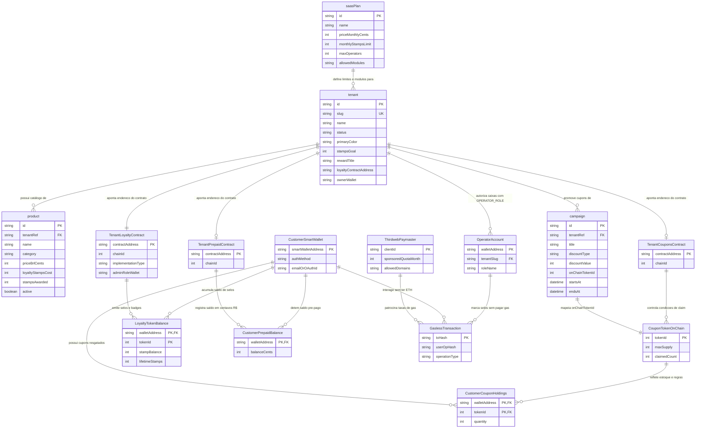

# 📊 Modelo Entidade-Relacionamento (ERD) — FidelizOn

Este documento especifica o **Modelo Entidade-Relacionamento (ERD)** da plataforma FidelizOn, mapeando de ponta a ponta a interação entre a **Camada de Conteúdo & Catálogo (Sanity CMS / Off-chain)** e a **Camada de Identidade & Regras Imutáveis (Thirdweb / Base L2 / On-chain)**.

---

## 1. Diagrama Entidade-Relacionamento

---

## 2. Detalhamento das Entidades

### 2.1. Camada Sanity CMS (Off-Chain / Content Lake)
1. **`saasPlan`**: Define a precificação B2B e as cotas operacionais de cada lojista (volume de selos/mês, número de caixas e módulos liberados).
2. **`tenant`**: Estabelecimento parceiro. Guarda chaves de customização visual (branding), regras do cartão de fidelidade (meta de selos, premiação) e os ponteiros para os contratos inteligentes on-chain.
3. **`product`**: Itens do cardápio/catálogo vinculados ao lojista, suportando precificação mista (R$ e selos) e gatilhos de pontuação.
4. **`campaign`**: Campanhas promocionais sazonais (ex.: cupons de Black Friday), com validade temporal e espelhamento on-chain.

### 2.2. Camada Thirdweb & Base L2 (On-Chain / Smart Contracts)
1. **`CustomerSmartWallet`**: Contas inteligentes (ERC-4337) geradas via In-App Wallet da Thirdweb (autenticação por Google, E-mail ou Passkey).
2. **`TenantLoyaltyContract`**: Contrato clone EIP-1167 exclusivo por loja (ERC-1155 Soulbound). O `tokenId = 0` armazena os selos e `tokenId = 1..N` armazena os badges conquistados.
3. **`TenantCouponsContract`**: Gerenciador de cupons com regras de resgate e queima (*burn*) definitiva no momento do uso.
4. **`TenantPrepaidContract`**: Ledger de saldo pré-pago em centavos de Real.
5. **`ThirdwebPaymaster`**: Infraestrutura que subsidia 100% das taxas de rede (*gasless*), blindando o usuário e o operador de qualquer atrito cripto.

---

## 3. Rastreabilidade Arquitetural
- **RFC Relacionada:** [RFC-001: Arquitetura SaaS B2B2C](./rfc_001_arquitetura_saas_b2b2c_da_plataforma_fidelizon.md)
- **Decisão Arquitetural:** [ADR-001: Infraestrutura e Configuração como Código](./adr_001_adocao_de_infraestrutura_e_configuracao_como_codigo.md)
